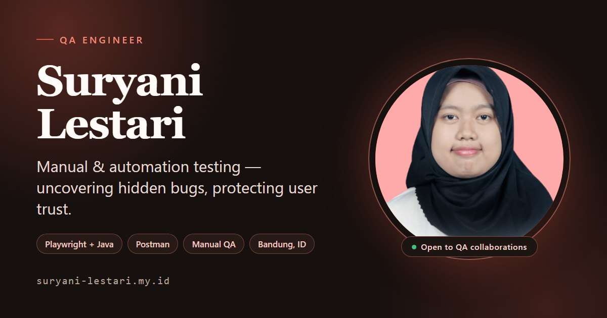

# Suryani Lestari — QA Portfolio

Personal portfolio for **Suryani Lestari**, QA Engineer (manual + automation).

[](https://github.com/sles1401/suryani-s-qa-portfolio/actions/workflows/ci.yml)
[](https://suryani-lestari.my.id)



The site is a bilingual (ID/EN) single-page application with light/dark themes. It covers the
profile, QA experience, selected projects, sanitized testing evidence, a downloadable CV, and two
interactive QA playgrounds.

## Highlights

- **Featured projects** — Hauling Management System work, OrangeHRM manual-testing portfolio, and a QA audit of this site, each with a case study.
- **Sanitized evidence** — test-management dashboard, bug-report, and regression-checklist samples with client data redacted.
- **Bug Hunter** — an interactive challenge where visitors inspect a mock app and log the planted defects.
- **API Console** — a simulated request/response console for methods, headers, payloads, and status codes (no network calls).
- **Resume** — experience, education, skills, and a one-page ATS-friendly CV.
- **Contact** — validated form with a same-origin delivery endpoint, FormSubmit fallback, mailto fallback, and a honeypot.
- **Accessibility** — skip link, keyboard-tested navigation, reduced-motion support, and axe checks in CI.
- **Self-hosted fonts** — Source Sans 3 and Playfair Display are bundled, so the site makes no font requests to third parties.
- **Privacy-friendly analytics** — Vercel Web Analytics (cookieless) tracks page views.
- **Bilingual & theme-aware** — Indonesian/English copy and light/dark themes persist across visits, with visual tests covering both.

## Tech stack

React 18 · TypeScript · Vite · Tailwind CSS · shadcn/ui · Radix UI · React Router · Framer Motion

## Routes

| Route | Description |
| --- | --- |
| `/` | Profile, metrics, featured projects, evidence, tools, experience |
| `/projects` | Project details, case studies, sanitized bug reports, audit results |
| `/projects/:slug` | Individual case study (HMS, OrangeHRM, portfolio audit) |
| `/resume` | Experience, education, skills, CV download |
| `/contact` | Contact details and validated form |
| `/bug-hunter` | Interactive bug-hunting challenge |
| `/api-console` | Simulated API testing console |

## Getting started

```sh
bun install
bun run dev        # http://localhost:8080
bun run build      # production build to dist/
bun run preview    # preview the production build
```

`npm install` and `npm run ...` work as well.

## Testing & quality gates

- **50 Playwright specs** — navigation, keyboard activation, focus order, theme persistence, visual snapshots (desktop, mobile, reduced motion), evidence hub, contact validation, and axe scans on every page.
- **Vitest unit tests** — language persistence, bilingual copy, and evidence-hub logic.
- **Performance budgets** — bundle-size gate plus Lighthouse budgets for light and dark themes.

| Command | Purpose |
| --- | --- |
| `bunx vitest run` | Unit tests |
| `bunx playwright test` | End-to-end tests and axe accessibility checks |
| `bun run lint` | ESLint |
| `bun run perf:bundle` | Bundle-size budget |
| `bun run perf:lighthouse` | Lighthouse budgets (light theme) |
| `bun run perf:lighthouse:dark` | Lighthouse budgets (dark theme) |

CI ([`ci.yml`](.github/workflows/ci.yml)) runs these checks on every push to `main`, with Playwright across Chromium, Firefox, and WebKit.

## Deployment

Deployed on Vercel. [`vercel.json`](vercel.json) provides the SPA fallback (so deep links such as
`/resume` work on refresh), long-lived caching for hashed assets, and security headers (CSP, HSTS,
`X-Content-Type-Options`, `Referrer-Policy`, `Permissions-Policy`, `X-Frame-Options`).

SEO/share assets live in `public/`: `robots.txt`, `sitemap.xml`, and a 1200×630 `og-image.jpg`.

### Contact endpoint

`api/contact.ts` is an edge function that sends mail through Resend. Set these environment
variables in Vercel (Project → Settings → Environment Variables):

| Variable | Purpose |
| --- | --- |
| `RESEND_API_KEY` | Resend API key |
| `CONTACT_TO_EMAIL` | Inbox that receives messages |
| `CONTACT_FROM_EMAIL` | Verified sender, e.g. `Portfolio <contact@your-domain>` |

If the function is not configured or fails, the client falls back to FormSubmit and then to the
visitor's mail client. The form also includes a hidden honeypot field.

### Analytics

Enable **Web Analytics** in the Vercel dashboard (Project → Analytics). The app renders
`<Analytics />` from `@vercel/analytics` and reports SPA route changes; no cookies are used.

## CV

The CV is generated from [`cv/cv.html`](cv/cv.html) and served at
`/cv/Suryani-Lestari-QA-CV.pdf`. To regenerate after editing the HTML:

```sh
chrome --headless=new --no-pdf-header-footer \
  --print-to-pdf=public/cv/Suryani-Lestari-QA-CV.pdf cv/cv.html
```

## Project structure

```
api/contact.ts                 edge endpoint for contact-form delivery (Resend)
cv/cv.html                     CV source (A4, one page)
public/                        favicon, robots.txt, sitemap.xml, og-image.jpg, cv/
src/components/home/           home sections (metrics, projects, evidence, tools, experience)
src/data/case-studies.ts       bilingual case-study content
src/components/layout/         header, footer, page shell
src/contexts/                  language and theme providers
src/hooks/use-page-meta.ts     per-route title, description, canonical, Open Graph
src/pages/                     route pages
e2e/                           Playwright + axe specs and visual snapshots
```

## Contact

- Email: [suryanilestari123@gmail.com](mailto:suryanilestari123@gmail.com)
- LinkedIn: [linkedin.com/in/suryani-lestari](https://www.linkedin.com/in/suryani-lestari)
- GitHub: [github.com/sles1401](https://github.com/sles1401)
